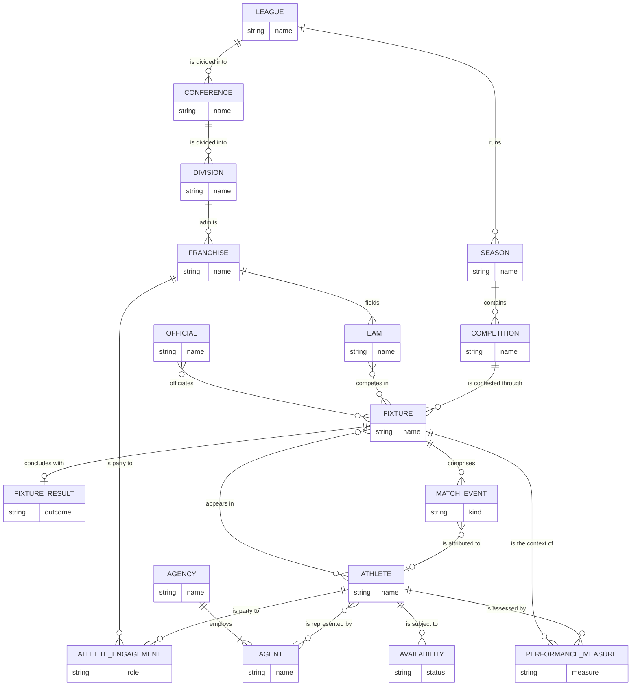
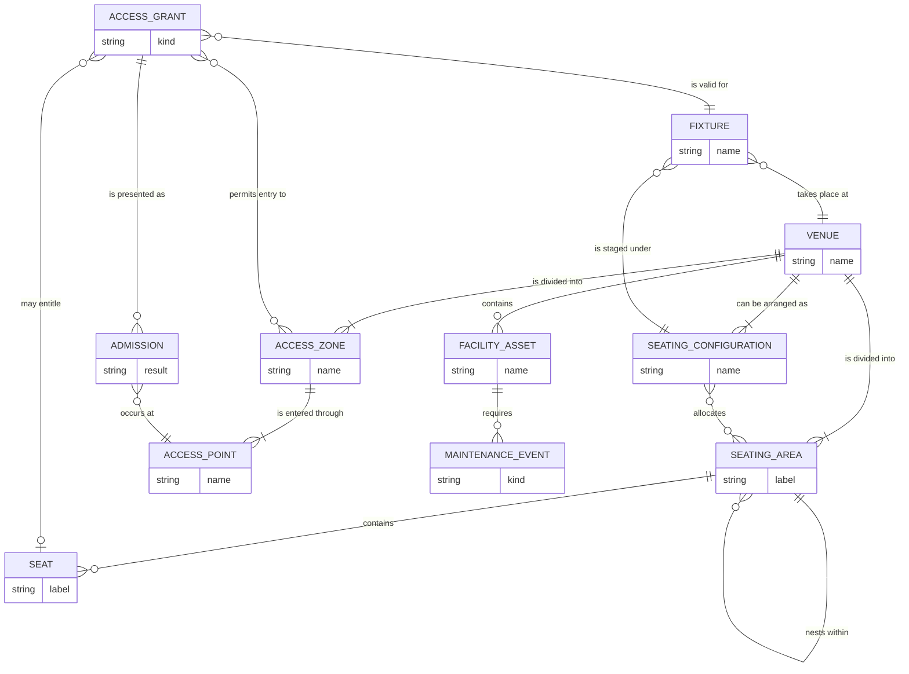
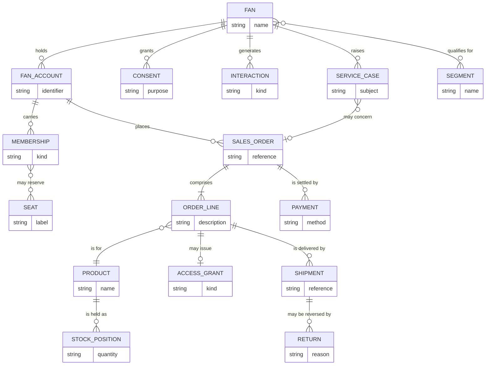
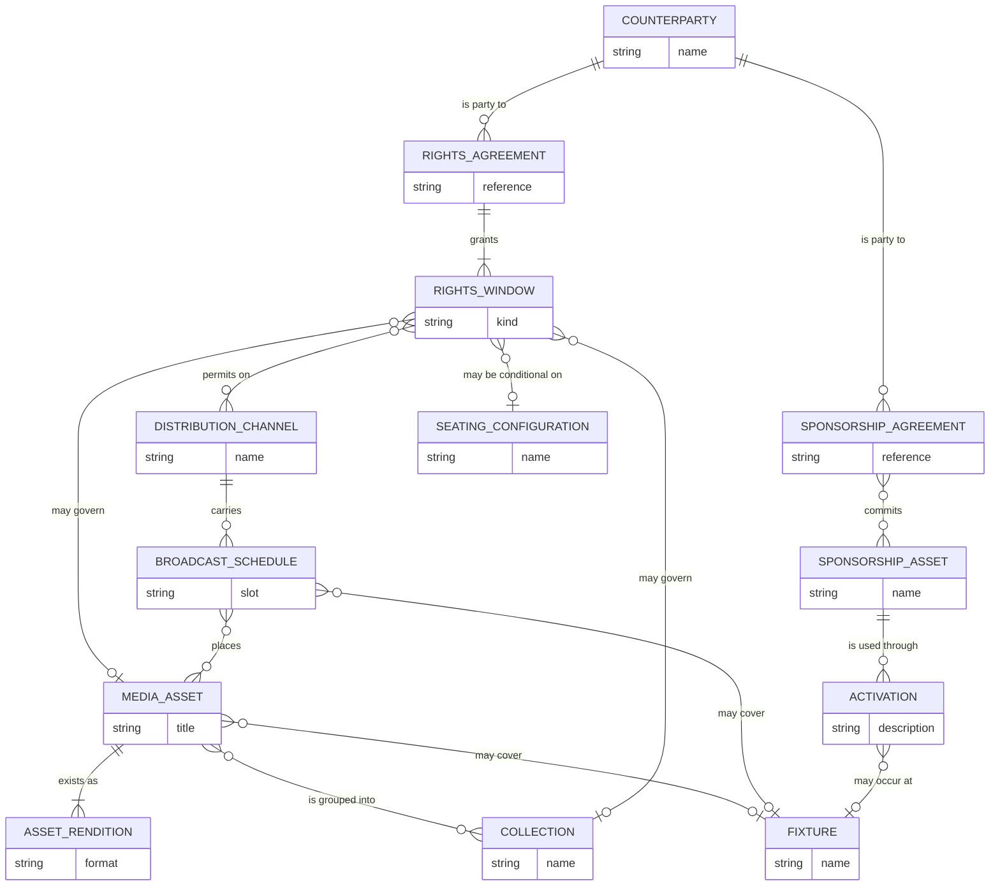
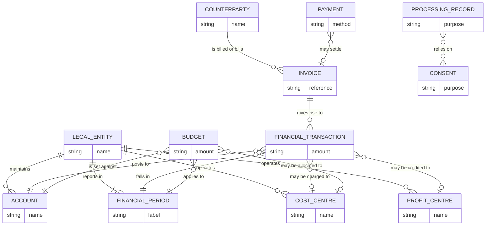
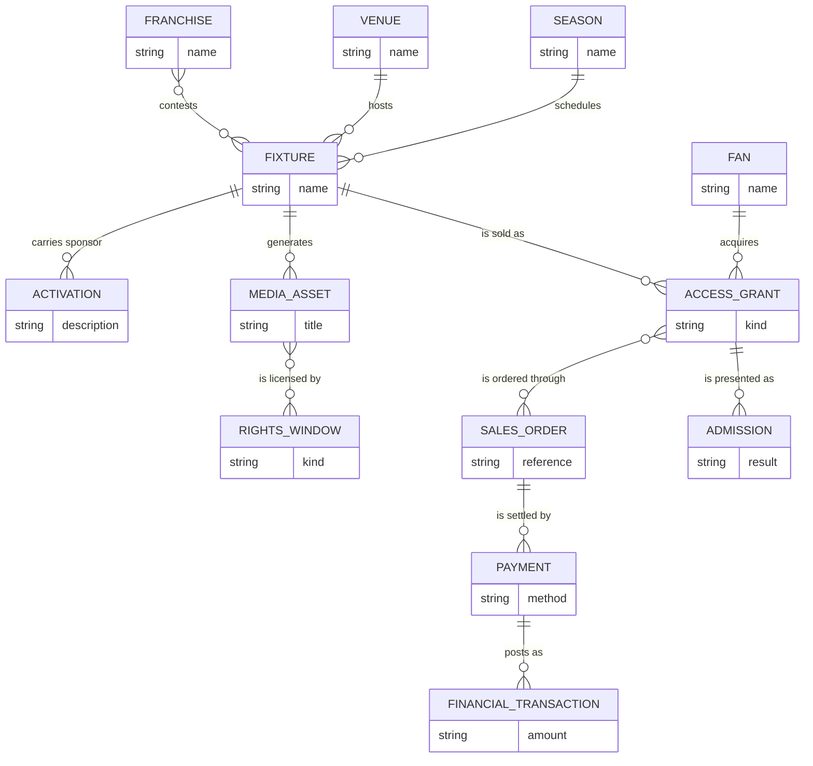

# Conceptual ERD

38 entities in five subject areas. Identifying attributes only — no keys, no
types, no foreign keys. Many-to-many relationships are drawn as such and are
resolved in the [logical model](../logical/).

Read [subject-areas.md](subject-areas.md) first; it explains why the areas are
grouped as they are and where they diverge from the upstream model's 14 domains.

## Notation

Mermaid crow's-foot. Cardinality is read left to right:

| Symbol | Meaning |
|---|---|
| `||--o{` | one to zero-or-many |
| `||--|{` | one to one-or-many |
| `}o--o{` | many to many (unresolved) |
| `||--o|` | one to zero-or-one |

## 1. Competition & Events

Two deliberate choices to notice. **Fixture covers every kind of event** — a
match, a concert, a bout, an awards night — differing only in whether a
Fixture Result exists; the logical model makes that a subtype. **Franchise and
Team are distinct**, because a franchise outlives relocation and rebranding
while fielding several teams at once.

## 2. Venue & Access

**Seating Area nests within itself.** Real venues go tier → block → section →
row, and the depth differs between venues and between configurations of the
same venue. A fixed three-level hierarchy, which is what the upstream model
has, is wrong for most of them.

**Access Grant is one entity covering a ticket and a staff pass**, because both
are permission for a person to be in a place during a period. **Admission is
separate from Access Grant**, and that separation is the point: a sold ticket
and an actual arrival are different facts, and the gap between them is the
no-show rate.

## 3. Commerce & Fan

**Sales Order is one entity.** A ticket order, a merchandise order, a renewal
and a subscription are the same conceptual act, and splitting them — which the
upstream model does across four tables — is a source-system distinction
promoted into the business model. It is why fan lifetime value needs a union
downstream.

**Fan and Fan Account differ in cardinality in both directions.** One household
account covers four fans; one fan holds accounts in three systems. Conflating
them is the commonest cause of double-counted supporters.

## 4. Media & Rights

**Media Asset and Asset Rendition are separate because the economics differ:**
the editorial decision is made once, the storage and delivery cost is incurred
once per rendition. **Rights Agreement and Rights Window are separate because
one deal grants many** — live in one territory, delayed in another, clips
globally, each with its own period and conditions.

The dashed-looking relationship at the bottom is the one worth staring at:
`RIGHTS_WINDOW` conditional on `SEATING_CONFIGURATION` is the
blackout-until-sellout term, which couples a broadcast rights rule to live
ticketing inventory. It crosses three subject areas and, in the physical tier,
three separate databases.

## 5. Corporate

**Budget and Financial Transaction are different kinds of thing** — an
intention and a fact. They live in different systems, are versioned
differently, and the upstream model treats budget as just another finance
table, which loses the version dimension: an approved budget and a what-if
scenario arrive indistinguishable.

## The spine

Stripped to the relationships that carry the business, the whole model is this:

Every one of those twelve relationships crosses a source-system boundary in the
physical tier. That is the whole reason `common.entity_xref` exists, and the
reason the target model's 1,477 cross-domain foreign keys are a product of
integration rather than something any source system hands over.
