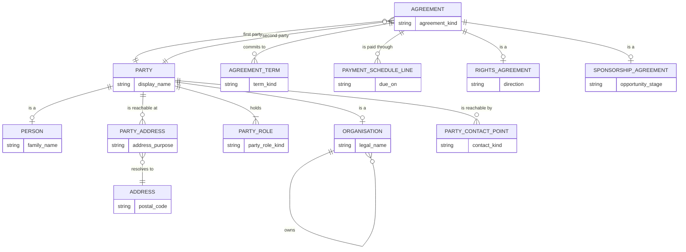
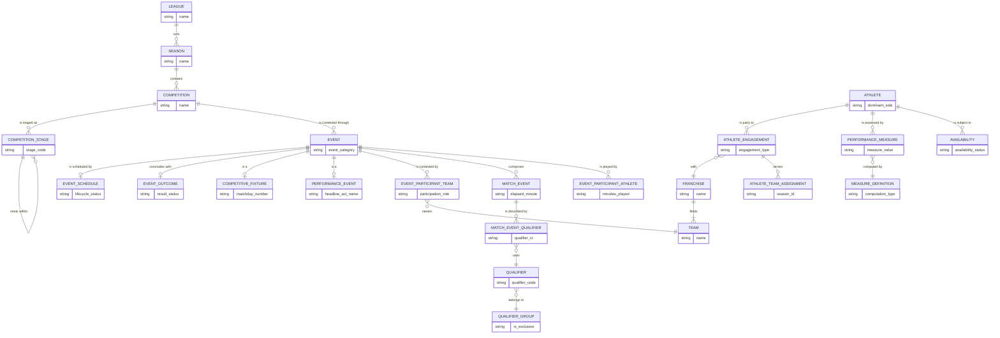
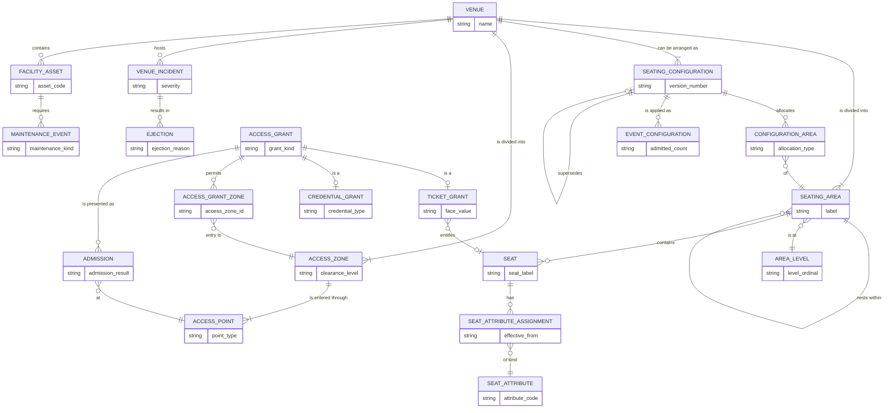
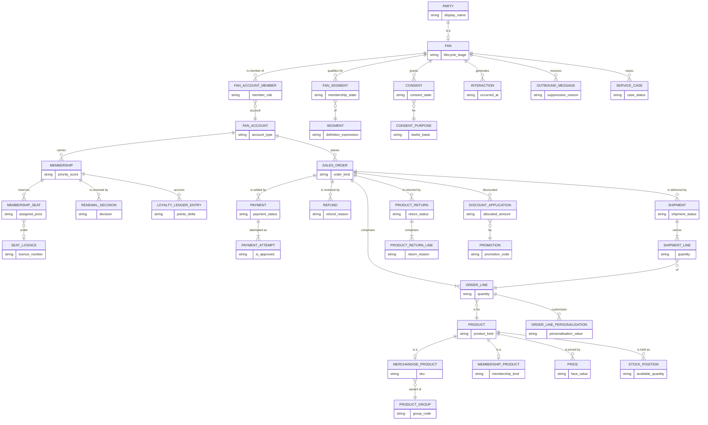

# Logical ERD

Rendered views of the five `.dbml` files. The DBML is authoritative — these
diagrams omit most attributes so the structure stays readable.

169 entities, 251 relationships, 32 of them associative. Counts are verified by
`tests/test_logical_model.py`, which also checks that every relationship
resolves to a declared table and column.

| Subject area | Entities | Relationships |
|---|--:|--:|
| Competition & Events | 37 | 54 |
| Venue & Access | 26 | 35 |
| Commerce & Fan | 44 | 64 |
| Media & Rights | 28 | 37 |
| Corporate | 34 | 61 |

## The two supertypes everything leans on

Before the subject areas, the structures that make the rest coherent. Both live
in [05-corporate.dbml](05-corporate.dbml).



`party_role` is the load-bearing piece. One party holds several roles,
concurrently or over time — an academy coach who holds a season ticket, a
retired athlete who becomes an agent. Modelling roles as separate top-level
tables, which is what the upstream model does across seven of them, makes that
impossible to state.

`agreement` is justified by the physical tier rather than by theory: nine kinds
of upstream agreement all resolve to a single SAP table (`veda`). The supertype
is not an abstraction imposed on the data — it is what the source system
already does.

## 1. Competition & Events

Event subtyping, and the recursive competition structure.



**`event` splits four ways by lifecycle**, not by type:
`event` (identity, fixed at announcement), `event_schedule` (revised by
operations), `event_outcome` (written afterwards by officials and analysis) and
the `competitive_fixture` / `performance_event` subtypes. The upstream
`event.fixture` is one 52-column table doing all of it, so a concert carries
`home_score`, `var_used` and `penalty_shootout` as nulls.

**`match_event_qualifier` is the most consequential associative entity in the
model.** It is what a coded match event *means* — "shot, right foot, inside
box, on target" is four rows. The upstream model has no equivalent anywhere, so
the semantics of every match event are lost on the way into the lakehouse and
only the aggregate number survives.

## 2. Venue & Access

The recursive seating hierarchy, and `access_grant` covering a ticket and a
pass.



**`seating_area` nests within itself** because real venues go tier → block →
section → row and the depth differs between venues and between configurations
of the same venue. The upstream model fixes three levels, which is wrong for
most of them.

**`admission` is separate from `access_grant`**, and that gap is the no-show
rate. It also keeps every *refused* presentation, which is what fraud
investigation reads and which the upstream model has no place for.

## 3. Commerce & Fan

One `sales_order` supertype, and the fan/account cardinality resolved.



**`fan_account_member` resolves the cardinality in both directions.** One
household account covers four fans; one fan holds accounts in three systems.
Conflating fan and account — which the upstream model does — is the commonest
cause of double-counted supporters.

**`sales_order` is one entity for every kind of purchase.** That is what makes
fan lifetime value a sum rather than a union across four tables.

**`payment_attempt` keeps the declines.** Four failures before a success is an
operational signal about the gateway and the customer; upstream only the
settled result survives.

## 4. Media & Rights

The asset/rendition and agreement/window separations.

```mermaid
erDiagram
    MEDIA_ASSET ||--|{ ASSET_RENDITION : "exists as"
    MEDIA_ASSET ||--o{ ASSET_METADATA_VALUE : "is described by"
    ASSET_METADATA_VALUE }o--|| METADATA_FIELD : "field"
    METADATA_FIELD }o--o| VOCABULARY : "drawn from"
    VOCABULARY ||--|{ VOCABULARY_TERM : contains
    VOCABULARY_TERM ||--o{ VOCABULARY_TERM : "nests within"
    MEDIA_ASSET ||--o{ ASSET_TAG : "is tagged by"
    ASSET_TAG }o--|| VOCABULARY_TERM : "with"
    MEDIA_ASSET ||--o{ ASSET_COLLECTION : "is grouped by"
    ASSET_COLLECTION }o--|| COLLECTION : into

    PRODUCTION_REQUEST ||--|{ PRODUCTION_STEP : comprises
    PRODUCTION_STEP ||--o| PRODUCTION_STEP : "depends on"
    EDITORIAL_BRIEF ||--o| PRODUCTION_REQUEST : commissions

    RIGHTS_AGREEMENT ||--|{ RIGHTS_WINDOW : grants
    RIGHTS_WINDOW ||--|{ RIGHTS_WINDOW_TERRITORY : "applies in"
    RIGHTS_WINDOW ||--o{ RIGHTS_WINDOW_CHANNEL : "permits on"
    RIGHTS_WINDOW ||--o{ RIGHTS_WINDOW_LANGUAGE : "in language"
    RIGHTS_WINDOW_CHANNEL }o--|| DISTRIBUTION_CHANNEL : channel
    RIGHTS_WINDOW }o--o| MEDIA_ASSET : governs
    PUBLICATION }o--o| RIGHTS_WINDOW : "permitted by"
    PUBLICATION }o--|| MEDIA_ASSET : publishes
    PUBLICATION }o--|| DISTRIBUTION_CHANNEL : to

    DISTRIBUTION_CHANNEL ||--o{ BROADCAST_SCHEDULE : carries
    BROADCAST_SCHEDULE ||--|{ SCHEDULE_ITEM : comprises
    DISTRIBUTION_CHANNEL ||--o{ LIVE_SIGNAL : "carries live"

    SPONSORSHIP_AGREEMENT ||--o{ AGREEMENT_ASSET_COMMITMENT : commits
    AGREEMENT_ASSET_COMMITMENT }o--|| SPONSORSHIP_ASSET : "asset"
    SPONSORSHIP_AGREEMENT ||--o{ ACTIVATION : "is delivered by"
    ACTIVATION ||--o{ ACTIVATION_MEASUREMENT : "is measured by"

    MEDIA_ASSET { string is_placeholder }
    ASSET_RENDITION { string rendition_role }
    ASSET_METADATA_VALUE { string value_order }
    METADATA_FIELD { string value_type }
    VOCABULARY { string is_open }
    VOCABULARY_TERM { string term }
    ASSET_TAG { string assigned_by }
    ASSET_COLLECTION { string display_order }
    COLLECTION { string collection_type }
    PRODUCTION_REQUEST { string request_kind }
    PRODUCTION_STEP { string step_status }
    EDITORIAL_BRIEF { string aspect_ratio }
    RIGHTS_AGREEMENT { string direction }
    RIGHTS_WINDOW { string blackout_until_sellout }
    RIGHTS_WINDOW_TERRITORY { string is_excluded }
    RIGHTS_WINDOW_CHANNEL { string distribution_channel_id }
    RIGHTS_WINDOW_LANGUAGE { string language_code }
    DISTRIBUTION_CHANNEL { string channel_type }
    PUBLICATION { string publication_status }
    BROADCAST_SCHEDULE { string broadcast_day }
    SCHEDULE_ITEM { string actual_duration_seconds }
    LIVE_SIGNAL { string is_clean }
    SPONSORSHIP_AGREEMENT { string loss_reason }
    AGREEMENT_ASSET_COMMITMENT { string delivered_quantity }
    SPONSORSHIP_ASSET { string asset_kind }
    ACTIVATION { string delivered_quantity }
    ACTIVATION_MEASUREMENT { string measurement_source }
```

**`rights_window` fans out into three associative entities** — territory,
channel and language — because a right is never a single value on any of those
axes. A window is "Europe except the UK, on these two channels, in these three
languages", and the upstream model has one column for each.

**`asset_rendition` is where the storage economics live.** Six renditions of one
asset are six rows here and one row upstream.

## 5. Corporate

```mermaid
erDiagram
    LEGAL_ENTITY ||--o{ COST_CENTRE : operates
    LEGAL_ENTITY ||--o{ PROFIT_CENTRE : operates
    LEGAL_ENTITY }o--|| CHART_OF_ACCOUNTS : uses
    LEGAL_ENTITY }o--|| FISCAL_CALENDAR : "reports on"
    CHART_OF_ACCOUNTS ||--|{ ACCOUNT : contains
    ACCOUNT ||--o{ ACCOUNT : "rolls up to"
    ACCOUNT ||--o{ ACCOUNT_ENTITY_SETTINGS : "configured per entity"
    FISCAL_CALENDAR ||--|{ FINANCIAL_PERIOD : defines
    FINANCIAL_PERIOD ||--o{ SEASON_PERIOD_MAPPING : "aligns to season"

    FINANCIAL_DOCUMENT ||--|{ FINANCIAL_TRANSACTION : comprises
    FINANCIAL_DOCUMENT }o--|| LEDGER : "posted to"
    FINANCIAL_DOCUMENT ||--o| FINANCIAL_DOCUMENT : reverses
    FINANCIAL_TRANSACTION }o--|| ACCOUNT : "posts to"
    FINANCIAL_TRANSACTION }o--o| COST_CENTRE : "charged to"
    FINANCIAL_TRANSACTION }o--o| PROFIT_CENTRE : "credited to"

    INVOICE ||--o| FINANCIAL_DOCUMENT : "posts as"
    INVOICE ||--o{ SETTLEMENT_ALLOCATION : "settled by"
    SETTLEMENT_ALLOCATION }o--|| SETTLEMENT : settlement
    SETTLEMENT }o--o| SETTLEMENT_RUN : "in run"
    FIXED_ASSET ||--|{ FIXED_ASSET_VALUATION : "valued as"

    PLAN_VERSION ||--o{ BUDGET_LINE : contains
    PLAN_VERSION ||--o{ PLAN_DRIVER : "driven by"
    PLAN_VERSION ||--o| PLAN_VERSION : "branches from"
    BUDGET_LINE }o--|| ACCOUNT : against
    BUDGET_LINE }o--|| FINANCIAL_PERIOD : "for"

    PROCESSING_RECORD ||--o{ PROCESSING_RECORD_CONSENT_PURPOSE : "relies on"
    DATA_SUBJECT_REQUEST }o--o| PARTY : concerns

    LEGAL_ENTITY { string entity_role }
    COST_CENTRE { string valid_to }
    PROFIT_CENTRE { string valid_to }
    CHART_OF_ACCOUNTS { string chart_code }
    FISCAL_CALENDAR { string calendar_code }
    ACCOUNT { string account_class }
    ACCOUNT_ENTITY_SETTINGS { string is_open_item_managed }
    FINANCIAL_PERIOD { string period_status }
    SEASON_PERIOD_MAPPING { string financial_period_id }
    FINANCIAL_DOCUMENT { string document_number }
    FINANCIAL_TRANSACTION { string signed_amount }
    LEDGER { string accounting_principle }
    INVOICE { string direction }
    SETTLEMENT_ALLOCATION { string allocated_amount }
    SETTLEMENT { string settled_on }
    SETTLEMENT_RUN { string is_proposal }
    FIXED_ASSET { string asset_number }
    FIXED_ASSET_VALUATION { string depreciation_area }
    PLAN_VERSION { string is_plan_of_record }
    BUDGET_LINE { string amount }
    PLAN_DRIVER { string driver_kind }
    PROCESSING_RECORD { string lawful_basis }
    PROCESSING_RECORD_CONSENT_PURPOSE { string consent_purpose_id }
    DATA_SUBJECT_REQUEST { string statutory_due_on }
    PARTY { string display_name }
```



**`cost_centre` and `profit_centre` carry the validity date in the key.** A
reorganisation creates a new row rather than updating the old one, which is
what makes historical postings still resolve to the structure that existed when
they were made. The upstream model keeps one row per centre, so a
reorganisation silently rewrites history.

**`plan_version` is the dimension the upstream model has no room for.** Actuals,
approved budget, working forecast and any number of scenarios coexist for the
same account, period and centre. `finance.budget` has one amount column, so
loading a scenario as the approved budget is a materially wrong answer rather
than a rounding difference.

**`season_period_mapping` is an honest admission.** A sports season and a
fiscal year are different things that happen to both be annual, and mapping one
to the other is the weakest join in the model. Making it an explicit
associative entity is better than burying it in a shared key, which is what the
upstream `league.season`-to-`finance.fiscal_period` relationship does.
